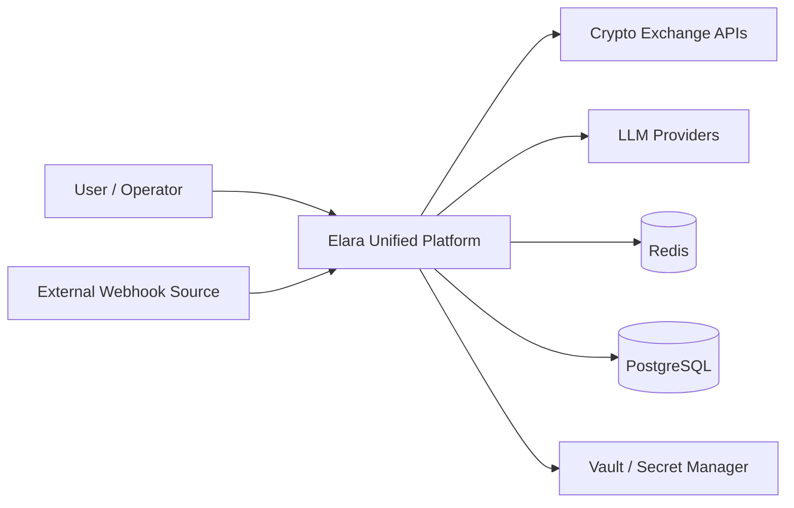
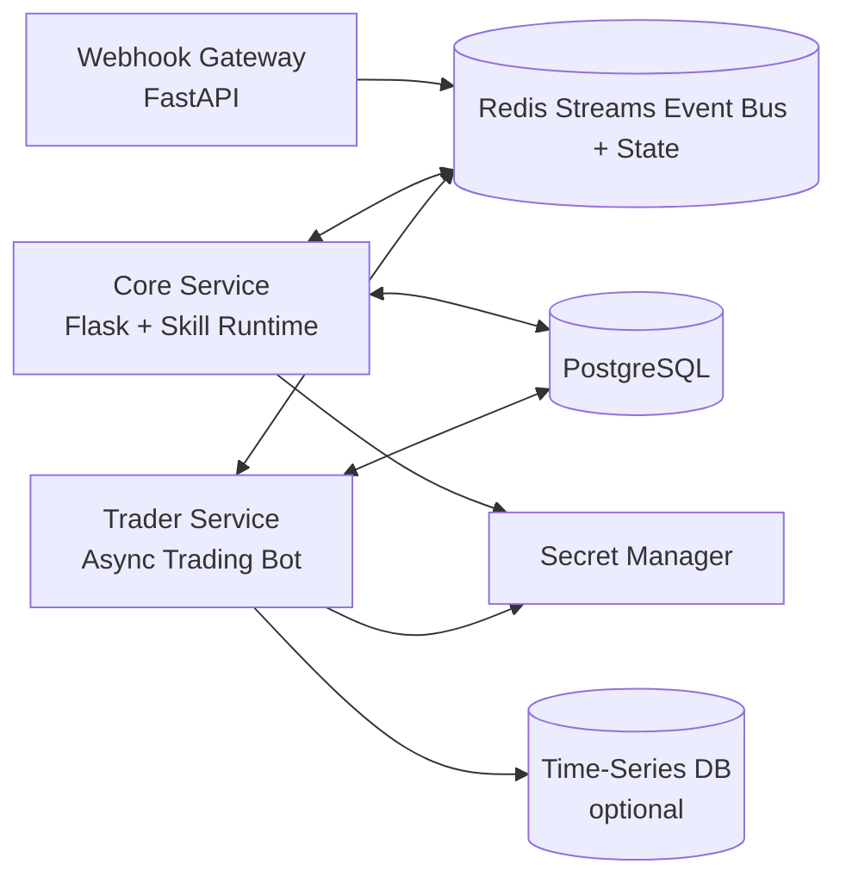

# Elara C4 Architecture

This view should be read together with `docs/architecture_doctrine.md`. The doctrine defines which layer is allowed to decide, govern, execute, observe, or degrade behavior.

## Level 1 - System Context



## Level 2 - Container View



## Level 3 - Component View (Core + Trader)

```mermaid
flowchart TD
    subgraph Core
      nlp[ElaraNLP]
      sm[StateManager\nRedis-first + encrypted payload]
      web[Web Factory\nRate limit + CSRF + Audit log]
      skills[SkillManager]
      otel[Observability\nJSON Log + OpenTelemetry]
    end

    subgraph Trader
      bot[TradingBot]
      ex[ExchangeConnector\nBatch OHLCV + sequence checks]
      dm[DataManager]
      analyzers[Lazy Analyzer Plugins\n(Sentiment / ML)]
      risk[Risk Guards\nDelist + Panic + Reconcile]
    end

    nlp --> skills
    skills --> sm
    web --> sm
    web --> otel
    bot --> ex
    bot --> dm
    bot --> analyzers
    bot --> risk
```

## Operational Notes

- State management is Redis-first. Memory fallback is explicit and controlled via `STATE_FALLBACK_MODE`.
- Redis Streams is the durable trade-signal ledger; Pub/Sub is compatibility notification only.
- Sensitive secrets resolve from env first, then secret provider (`file`, `aws`, `vault`) via `utils/secret_provider.py`.
- Security-sensitive API actions are audit logged.
- Webhook processing is async with `BackgroundTasks` to avoid sender retries due to long request handling.
- Trading status metrics can optionally be written to a TSDB sink for long-range observability.
- Core requests trading actions, trader executes guarded commands, and `trading_core/` owns decision contracts.
- Execution should only receive an `ExecutionPlan` after risk, runtime, governance, and reasoned-decision gates are explicit.


