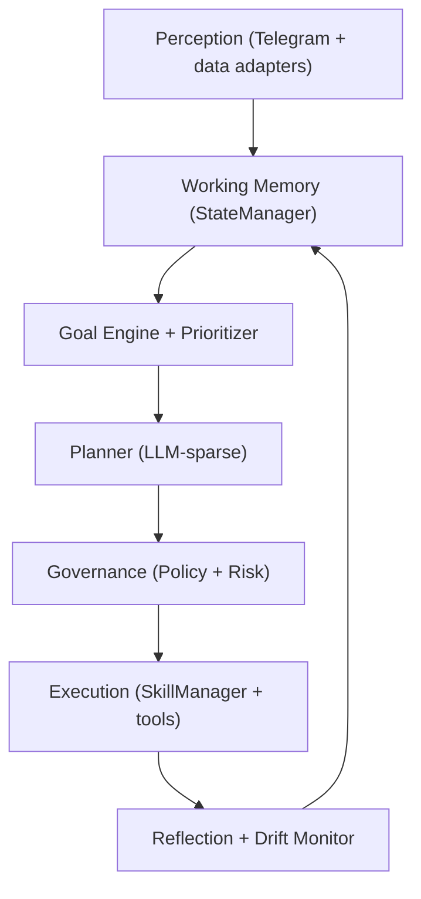

# Agent OS Implementation Plan (Rebased)

Prioritas: Personal AI OS → Trading fund → Autonomous decision engine. Interface utama: Telegram. Autonomy awal: suggestion-only.

## Architecture Snapshot

## Phase 0 — Identity Anchor
- Source of truth: `runtime/identity_anchor.json` (override) or `config/identity_anchor.json` (fallback).
- Enforced by policy engine before any execution.
- Versioned anchor + action allow/block list + approval risk levels.
- Goal dedupe + max queue + per-cycle action budget.

## Phase 1 — Telegram Intake + Working Memory
- Telegram remains primary command surface.
- `StateManager` stores world state and goal queue with TTL.
- NLU provider chain (OpenAI/Groq/Gemini) with tool-call cache TTL.

## Phase 2 — Context Governance
- Hard cap goals: 1 active, 2–3 sub-goals.
- Context budget enforced per layer (system/task/evidence).

## Phase 3 — Goal Engine
- Goal schema + scoring.
- Priority queue + TTL + preemption rules.
- Dependency gating and duplicate goal merge.

## Phase 4 — Planner + Decision (LLM-sparse)
- Planner only proposes steps.
- Decision engine deterministic.
- Tool availability guard before actions are proposed.

## Phase 5 — Governance Layer
- Policy + risk check gates before execution.
- Approval required for critical actions.
- Risk appetite thresholds + action allow/block list + approval hints in plan output.

## Phase 6 — Execution + Audit
- All actions run through `SkillManager`.
- Event ledger and idempotency for auditability.

## Phase 7 — Reflection + Drift
- Compare outcomes to identity anchor.
- Adjust goal scores and block drifted actions.

## Phase 8 — Trading Domain Plug-in
- `trading_core` operates in shadow mode first.
- Live actions remain blocked until governance confidence is stable.

