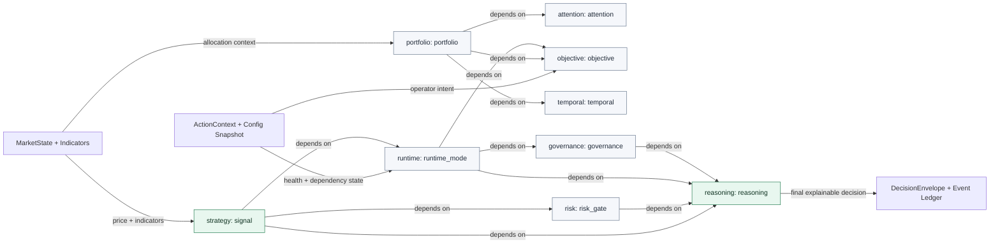

# Decision Topology

This is the current external cognition map for Elara's trading decision path. It exists so the flow can be reviewed without loading the whole codebase into working memory.

Generate the Mermaid source with:

```powershell
python scripts/render_decision_topology.py
```



## Reading Rule

The diagram is not a feature map. It is a responsibility map.

If a subsystem changes the final action, execution eligibility, allocation, runtime mode, or governance outcome, it must show up as one of:

- a pipeline trace step
- a reasoning component
- a lifecycle event
- an explicit constraint

Hidden mutation is treated as architectural debt.
